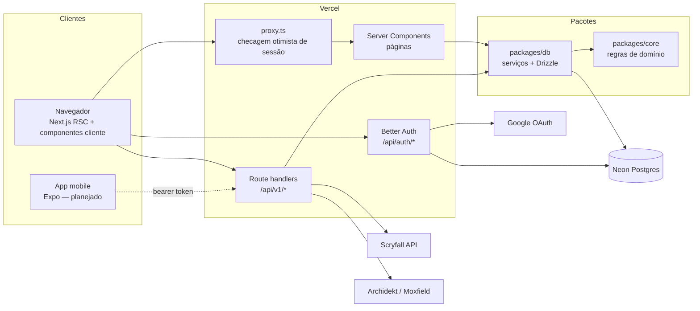
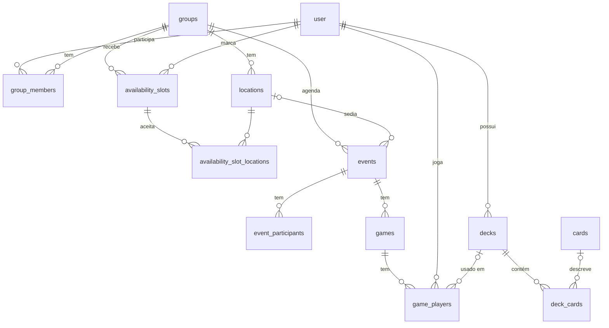

# Arquitetura

## Visão geral

### Camadas

| Camada  | Onde            | Responsabilidade                                                                                                                                                                      | Depende de                  |
| ------- | --------------- | ------------------------------------------------------------------------------------------------------------------------------------------------------------------------------------- | --------------------------- |
| Domínio | `packages/core` | Regras puras: janelas de disponibilidade, validação de partidas, ranking, parsing/importação de decks, cliente Scryfall (com `fetch` injetado), análise de deck. Sem banco, sem Next. | `zod`                       |
| Dados   | `packages/db`   | Schema Drizzle, migrations, **serviços** (casos de uso que leem/escrevem no banco e aplicam regras do core, incluindo permissões).                                                    | `core`, `drizzle-orm`, `pg` |
| Web     | `apps/web`      | UI (Server Components para leitura, componentes cliente chamando a API para escrita), API REST fina (auth + validação Zod + serviço), autenticação e i18n.                            | `db`, `core`, Next.js       |

Por que assim:

- **Mobile no futuro.** O app Expo vai consumir a mesma API REST (`/api/v1`) e importar `@boramarcar/core` para lógica de cliente (ex.: mostrar a curva de mana offline). Nada em `core` depende de Node, React ou banco.
- **Testabilidade.** Regras ficam em funções puras (testes unitários rápidos); serviços são testados contra Postgres real em memória (PGlite) com as migrations de verdade; route handlers são testados chamando as funções exportadas.
- **Rotas finas.** Cada route handler só autentica, valida a entrada com Zod e chama um serviço. O wrapper `authed()` em `apps/web/src/server/http.ts` converte `DomainError` em status HTTP.

### Erros

`DomainError(code, message)` (em `core`) é a única forma de sinalizar erros esperados. Códigos e status:

| Código           | HTTP                                       |
| ---------------- | ------------------------------------------ |
| `invalid_input`  | 400                                        |
| `unauthorized`   | 401                                        |
| `forbidden`      | 403                                        |
| `not_found`      | 404                                        |
| `conflict`       | 409                                        |
| `upstream_error` | 502 (Archidekt/Moxfield/Scryfall falharam) |

A UI traduz o código com `errors.<code>` nas mensagens.

## Modelo de dados

- `user`, `session`, `account`, `verification`: tabelas do Better Auth.
- `availability_slots` + `availability_slot_locations`: um intervalo de tempo de um jogador; sem locais vinculados = "qualquer local".
- `games.group_id` é desnormalizado para consultas de ranking por grupo.
- `game_players.result` ∈ `win | loss | draw`; validação: no máximo um vencedor; com vencedor não há empate; sem vencedor alguém empatou.
- `cards` é um **cache** do Scryfall (por `scryfall_id`); `deck_cards.card_name` guarda o nome mesmo quando a carta não foi encontrada.
- `deck_cards.is_proxy`: uma mesma carta pode ter uma linha original e outra proxy (índice único por deck/board/nome/proxy).

## Algoritmos

### Janelas de disponibilidade (`core/availability`)

Varredura de intervalos: os limites de todos os intervalos dividem a linha do tempo em segmentos; para cada local candidato e segmento, contamos quem está disponível e aceita aquele local (ou qualquer local). Segmentos contíguos com o mesmo conjunto de jogadores são unidos, janelas menores que a duração mínima são descartadas, e o resultado é ordenado por número de jogadores, duração e horário. Complexidade O(L · S · N) — irrelevante para grupos de amigos.

### Ranking (`core/ranking`)

Pontos configuráveis (padrão: vitória 3, empate 1, derrota 0). Desempate: pontos → vitórias → % de vitórias → menos jogos. Jogadores empatados em todos os critérios dividem a posição.

### Análise de deck (`core/analysis`)

1. Classificação de cada carta por **expressões regulares no texto de regras** (ramp, compra, remoção, wipes).
2. Curva de mana (mainboard, sem terrenos), símbolos de mana por cor, CMC médio.
3. Nota de 0 a 100 comparando com metas comuns de Commander: 36–38 terrenos (25 pts), 10 ramp (20), 10 compra (20), 8 remoções (15), 2 wipes (10), CMC médio ≤ 3 (10).
4. Validação de Commander: 100 cartas, 1–2 comandantes, singleton (exceto básicos e "any number"), identidade de cor.
5. Sugestões com uma busca pronta no Scryfall (`id<=<cores> otag:<função> f:commander cmc<=3`).

É deliberadamente simples: a fase 4 do [roadmap](ROADMAP.md) troca as regex pelas tags do Scryfall Tagger e adiciona substituições reais.

## Autenticação

Better Auth com o provedor Google e adaptador Drizzle. Sessões ficam no Postgres; o cookie é cacheado por 5 minutos (`cookieCache`) para evitar uma consulta por requisição. `proxy.ts` (antigo `middleware.ts` no Next 16) só verifica a presença do cookie; a validação real acontece nas páginas (`requireUser`) e na API (`authed`).

## Internacionalização

next-intl sem prefixo de idioma na URL. O idioma vem do cookie `NEXT_LOCALE` e, na falta dele, do `Accept-Language`; padrão `pt-BR`. As mensagens são tipadas a partir de `messages/pt-BR.json` e um teste garante que `en.json` tem as mesmas chaves. O fuso horário padrão é `America/Sao_Paulo` (fuso por usuário está no roadmap).
