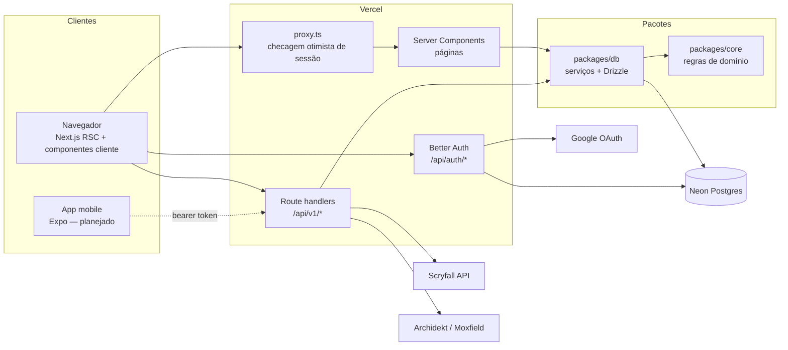
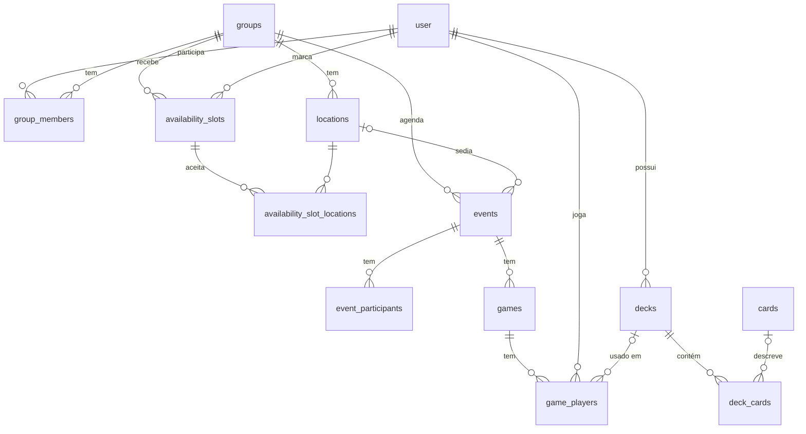

# Arquitetura

## Visão geral

### Camadas

| Camada  | Onde            | Responsabilidade                                                                                                                                                                      | Depende de                  |
| ------- | --------------- | ------------------------------------------------------------------------------------------------------------------------------------------------------------------------------------- | --------------------------- |
| Domínio | `packages/core` | Regras puras: janelas de disponibilidade, validação de partidas, ranking, parsing/importação de decks, cliente Scryfall (com `fetch` injetado), análise de deck. Sem banco, sem Next. | `zod`                       |
| Dados   | `packages/db`   | Schema Drizzle, migrations, **serviços** (casos de uso que leem/escrevem no banco e aplicam regras do core, incluindo permissões).                                                    | `core`, `drizzle-orm`, `pg` |
| Web     | `apps/web`      | UI (Server Components para leitura, componentes cliente chamando a API para escrita), API REST fina (auth + validação Zod + serviço), autenticação e i18n.                            | `db`, `core`, Next.js       |

Por que assim:

- **Mobile no futuro.** O app Expo vai consumir a mesma API REST (`/api/v1`) e importar `@boramarcar/core` para lógica de cliente (ex.: mostrar a curva de mana offline). Nada em `core` depende de Node, React ou banco.
- **Testabilidade.** Regras ficam em funções puras (testes unitários rápidos); serviços são testados contra Postgres real em memória (PGlite) com as migrations de verdade; route handlers são testados chamando as funções exportadas.
- **Rotas finas.** Cada route handler só autentica, valida a entrada com Zod e chama um serviço. O wrapper `authed()` em `apps/web/src/server/http.ts` converte `DomainError` em status HTTP.

### Erros

`DomainError(code, message)` (em `core`) é a única forma de sinalizar erros esperados. Códigos e status:

| Código           | HTTP                                       |
| ---------------- | ------------------------------------------ |
| `invalid_input`  | 400                                        |
| `unauthorized`   | 401                                        |
| `forbidden`      | 403                                        |
| `not_found`      | 404                                        |
| `conflict`       | 409                                        |
| `upstream_error` | 502 (Archidekt/Moxfield/Scryfall falharam) |

A UI traduz o código com `errors.<code>` nas mensagens.

## Modelo de dados

- `user`, `session`, `account`, `verification`: tabelas do Better Auth.
- `availability_slots` + `availability_slot_locations`: um intervalo de tempo de um jogador; sem locais vinculados = "qualquer local".
- `games.group_id` é desnormalizado para consultas de ranking por grupo.
- `game_players.result` ∈ `win | loss | draw`; validação: no máximo um vencedor; com vencedor não há empate; sem vencedor alguém empatou.
- `cards` é um **cache** do Scryfall (por `scryfall_id`); `deck_cards.card_name` guarda o nome mesmo quando a carta não foi encontrada.
- `deck_cards.is_proxy`: uma mesma carta pode ter uma linha original e outra proxy (índice único por deck/board/nome/proxy).

## Algoritmos

### Janelas de disponibilidade (`core/availability`)

Varredura de intervalos: os limites de todos os intervalos dividem a linha do tempo em segmentos; para cada local candidato e segmento, contamos quem está disponível e aceita aquele local (ou qualquer local). Segmentos contíguos com o mesmo conjunto de jogadores são unidos, janelas menores que a duração mínima são descartadas, e o resultado é ordenado por número de jogadores, duração e horário. Complexidade O(L · S · N) — irrelevante para grupos de amigos.

### Ranking (`core/ranking`)

Pontos configuráveis (padrão: vitória 3, empate 1, derrota 0). Desempate: pontos → vitórias → % de vitórias → menos jogos. Jogadores empatados em todos os critérios dividem a posição.

### Tipos de jogo (`core/games`)

Cada partida tem um `format` (texto, para poder adicionar tipos sem migration) com regras em `FORMAT_RULES`: **todos contra todos** (Commander, Brawl, Oathbreaker, Outro — 2 a 8 jogadores, um vencedor ou empate), **duelo** (Standard, Pioneer, Modern, Legacy, Vintage, Pauper, Draft, Selado — 2 jogadores) e **times** (Two-Headed Giant — dois times de 2; vence o time inteiro, então há 2 vencedores). Detalhes opcionais para estatísticas: quem começou, turno em que acabou, duração e ordem de eliminação. As configurações do grupo (`groups`: mesa, duração mínima, pontos e tipo padrão) valem para sugestões de horário, ranking e formulário de partida.

### Estatísticas e temporadas (`core/stats`)

`computeGroupStats` percorre as partidas em ordem cronológica: sequências de vitórias (atual e melhor), quem começou e venceu, quem saiu primeiro (menor ordem de eliminação), confronto direto (só adversários — em times, colegas não contam), vitórias por posição na mesa (só todos contra todos com 3+ jogadores), médias de turno e duração, e decks (partidas, vitórias, %). O serviço junta nomes, capas dos decks e agrupa por comandante. `resolvePeriod` traduz o filtro da página (todas, últimos 30 dias, este ano no fuso do usuário, ou uma temporada da tabela `seasons`, com fim exclusivo) em `[from, to)`, usado igualmente pelo ranking e pelas estatísticas.

### Análise de deck (`core/analysis`)

A análise depende do **formato do deck** (`decks.format`, escolhido na importação ou detectado no Archidekt/Moxfield; `formats.ts` tem o perfil de cada um):

| Perfil     | Formatos                                                                                  | Regras verificadas                                          | Nota |
| ---------- | ----------------------------------------------------------------------------------------- | ----------------------------------------------------------- | ---- |
| Comandante | Commander (100, 1–2 comandantes), Brawl (100, 1), Oathbreaker (60, planeswalker + mágica) | tamanho exato, singleton, identidade de cor                 | sim  |
| Construído | Standard, Pioneer, Modern, Legacy, Vintage, Pauper, Two-Headed Giant                      | mínimo 60, até 4 cópias (principal + reserva), reserva ≤ 15 | não  |
| Limitado   | Draft, Selado                                                                             | mínimo 40                                                   | não  |
| Livre      | Outro                                                                                     | só cartas desconhecidas                                     | não  |

Banidas, restritas (1 cópia) e cartas fora do formato são conferidas pelo campo `legalities` do Scryfall (guardado em `cards.legalities`, atualizado pelo cron diário); básicos não são apontados. Formatos sem lista (limitados, Two-Headed Giant, Outro) não conferem.

1. **Funções** (4.5): as do **Scryfall Tagger** (`otag:ramp`, `card-advantage`, `removal`, `sweeper`, `tutor`, `protection`, `recursion`, `counterspell`), guardadas em `cards.roles` por 30 dias; enquanto a carta não foi consultada, vale a heurística por regex no texto. A tela mostra quantas cartas vieram do Tagger.
2. Curva de mana (principal, sem terrenos), símbolos por cor, CMC médio.
3. **Nota 0–100** só nos formatos com comandante: terrenos (25), ramp (20), compra (20), remoção (15), wipes (10), curva (10), com metas do perfil (Oathbreaker tem metas menores).
4. **Alternativas** (4.6): `GET /api/v1/decks/:id/alternatives?role&maxCmc` busca no Scryfall `id<=<cores> otag:<função> f:<formato> cmc<=N` ordenado por EDHREC e tira as cartas que já estão no deck.
5. **Bracket** (4.7, só Commander): `estimateBracket` aplica as regras objetivas dos brackets oficiais (Game Changers: nenhum até o 2, até 3 no 3; destruição em massa de terrenos e turnos extras encadeados → 4+; combo de duas cartas → 4+, "talvez de duas" → 3+). Os sinais vêm do endpoint `estimate-bracket` do **Commander Spellbook** e ficam em `decks.bracket_signals` com o hash da lista (`bracket_hash`); se a lista mudou, a tela usa só os Game Changers do Scryfall até a próxima consulta. O resultado é um mínimo — intenção e velocidade ficam com a mesa.
6. **Base de mana** (4.8): terrenos que geram cada cor (`cards.produced_mana`) contra uma meta proporcional aos símbolos, com mínimo de 10 (Commander) ou 7 (60 cartas) para splash.
7. **Gráficos interativos** (4.11): a curva mostra as cartas de cada custo (`cardsByCurve`) e cada componente da nota traz a meta usada (`ScoreComponent.target`) para a tela explicar o cálculo.
8. **Comparação** (4.10): os [termos do EDHREC](https://edhrec.com/terms) proíbem consultas automáticas e limitam o uso a fins pessoais, então a média vem dos **decks do próprio app** com o mesmo conjunto de comandantes que a pessoa pode ver (os dela, públicos e de grupo de quem divide grupo com ela; até 50): nota, terrenos, CMC e funções, cartas presentes em ≥ 50% deles que faltam no deck e escolhas próprias. A popularidade por carta usa o `edhrec_rank` que o **Scryfall** publica na API dele; o EDHREC entra só como link para a página do comandante.
9. **Mão inicial** (4.9): hipergeométrica — distribuição de terrenos na mão de 7, chance de 2–4 terrenos, jogada de terreno em todos os turnos até o 2–5 (jogando primeiro/depois) e ramp até o turno 2–3.

**Atualização dos dados externos** (`server/deck-analysis.ts`): depois de importar ou sincronizar (e ao abrir um deck com dados velhos), `refreshDeckAnalysis` roda após a resposta (`after`) e, em etapas independentes, completa a mana produzida de cartas de cache antigo, consulta o Tagger (~8 funções × 2–3 buscas de até 1000 caracteres, 100 ms entre elas) e o Spellbook. O botão "Atualizar análise" chama `POST /api/v1/decks/:id/analysis`.

## Locais do grupo e mapas

Locais (`locations`) têm nome, endereço, complemento, coordenadas (`lat`/`lng`), anfitrião e quem cadastrou. Qualquer membro cadastra; editar e remover cabe a dono/admin, a quem cadastrou e ao anfitrião. Remover um local deixa os encontros com "local a definir".

- **Autocompletar**: `GET /api/v1/places?q=` chama o [Photon](https://photon.komoot.io) (OpenStreetMap), que aceita busca enquanto se digita (o Nominatim não aceita). O servidor guarda as buscas por 24 h em memória e o campo espera 400 ms sem digitação e 3 letras; os resultados priorizam a região do primeiro local do grupo.
- **Número da casa**: no Brasil o OpenStreetMap raramente tem a numeração, então o Photon devolve só a rua. Quando o texto digitado tem número (`houseNumberFrom`, ignora CEP), a sugestão da rua leva o número no rótulo e vem marcada como `approximate`; ao escolhê-la, o formulário chama `GET /api/v1/places/locate?q=` uma vez, que busca o endereço no [Nominatim](https://nominatim.org) (também usa a numeração interpolada) e só aceita resultado com `house_number`. Achou: o pino vai para o número. Não achou: o pino fica na rua e o formulário avisa para arrastá-lo; o endereço salvo mantém o número. Respostas também ficam 24 h em cache.
- **Mapa**: Leaflet com os tiles do OpenStreetMap e o crédito exigido; o pino é um `divIcon` em CSS. No formulário, clicar no mapa ou arrastar o pino ajusta as coordenadas.
- **Rotas**: `directionsLinks` (core) monta os links para Google Maps, Apple Maps, Waze e OpenStreetMap (coordenadas ou, sem elas, o endereço).
- Na página do encontro aparece o local com mapa e rotas.

## Modo mesa (contador de vida)

`/mesa/:encontro` abre em tela cheia (fora do layout do app) para o celular deitado no meio da mesa, no estilo dos contadores de mesa como o Lotus: uma área por jogador (2 a 6), virada para quem senta daquele lado (sentido horário a partir do canto superior esquerdo), toque nas metades para ±1 e segurar para ±10, total recente ("−2") que some em 1,5 s, e um botão central com desfazer, d20, moeda, sorteio de quem começa, **trocar lugares** (toca-se em dois jogadores e eles trocam de área, para a tela refletir onde cada um sentou; a ordem vira o `seat` da partida e dá para desfazer) e encerrar.

- Lógica pura em `core/table` (`tableReducer`): vida, dano de comandante por origem (também tira vida), veneno, energia, experiência, imposto do comandante, monarca, concessão e desfazer. Derrota por vida ≤ 0, 10 de veneno, 21 de um mesmo comandante (só formatos com comandante) ou desistência; a ordem de eliminação vem do passo em que cada um caiu.
- A partida fica no `localStorage` do aparelho (continua depois de recarregar ou bloquear a tela) e a tela fica acesa com a Wake Lock API quando o navegador permite.
- Ao encerrar, o resultado sugerido (último vivo vence; os demais na ordem em que caíram) é conferido e salvo com `POST /api/v1/events/:id/games` (formato, quem começou, turno, duração).
- Formatos de time (Two-Headed Giant) continuam no formulário do encontro.
- **No app** (`apps/mobile/src/app/mesa/[id].tsx`): o mesmo reducer e a mesma disposição (`tableLayout`/`tableRows` do core; cada área é girada com `transform`), com toque ±1 e segurar ±10 (`onLongPress` repete a cada 0,6 s), vibração leve (`expo-haptics`), tela acesa (`expo-keep-awake`) e a partida salva num arquivo por encontro (`expo-file-system`). Os dados da mesa vêm de `GET /api/v1/events/:id/table` (jogadores do grupo, confirmados primeiro, com os decks de cada um, e o formato padrão), o mesmo `getTableSetup` da página do site.

## Página inicial

`/` é pública e igual para todos (não redireciona mais quem já entrou): apresentação, funcionalidades, fontes de dados, metodologia da análise (os pontos da nota vêm de `ROLE_POINTS` do core), valores e o convite para os testes (e-mail). O menu superior leva ao painel (ou faz o login com o Google, que volta para `/painel`). O vídeo abstrato do topo (`public/home/hero.webm|mp4` + capa `hero-poster.webp`) é gerado por `apps/web/scripts/hero-video.py` (quadros em Python + ffmpeg, loop de 12 s).

## Notificações por e-mail

- **Quando**: encontro novo (grupo todo), encontro alterado ou cancelado (quem não recusou), lembrete das próximas 24h (cron diário da Vercel em `/api/cron/reminders`, protegido por `CRON_SECRET`) e "a mesa fechou!" (depois de alguém marcar disponibilidade, se surge uma janela nos próximos 14 dias sem encontro marcado). Quem fez a ação não recebe o próprio aviso.
- **Uma vez só**: o lembrete marca `events.reminder_sent_at` com um `UPDATE ... WHERE reminder_sent_at IS NULL` (remarcar zera o campo); "a mesa fechou!" grava a chave `dia|local` em `window_notifications` (`ON CONFLICT DO NOTHING`).
- **Sem atrasar a resposta**: as rotas agendam o envio com `after()` do Next (`server/background.ts`); erros vão para o log e não afetam a ação do usuário.
- **Conteúdo**: `server/email.ts` monta HTML (texto escapado) e texto puro no idioma (`user.locale`) e no fuso (`user.time_zone`) de quem recebe, com o `.ics` anexo (mesmo UID/SEQUENCE do download, então a agenda atualiza o evento). `core/email` fala com a API do Resend, um e-mail por destinatário.
- **Opt-out**: `user.email_notifications`, no perfil. Sem `RESEND_API_KEY`, nada é enviado.

## Perfis, visibilidade e conquistas

- **Visibilidade do deck** (`decks.visibility`): `private` (só o dono), `group` (padrão: quem divide grupo com o dono) e `public` (qualquer pessoa com conta e o link). Vale para a página do deck e para o perfil.
- **Perfil do jogador** (`/jogadores/:id`, API `/api/v1/players/:id`): só para quem divide um grupo (senão, 404 — não revela quem usa o app). Mostra resumo, títulos de temporada, conquistas e decks visíveis; e-mail e grupos que não são em comum só para o próprio jogador.
- **Conquistas** (`core/achievements`): calculadas na hora a partir das partidas (sem tabela), em ordem cronológica, com a data em que cada objetivo foi alcançado — editar ou remover uma partida recalcula tudo. "Campeão da temporada" usa o ranking de cada temporada encerrada.

## Preços em reais

O Scryfall só tem preço em dólar. O valor em reais é **conversão** pelo dólar PTAX de venda do Banco Central (API pública `olinda.bcb.gov.br`, sem chave), guardado por 6 h na memória da instância e no cache compartilhado do banco (ver "Serviços externos"); se o BCB falhar, a página mostra só US$. A LigaMagic não tem API pública e bloqueia acesso automático, então cada carta tem um link "Ver preço na LigaMagic" em vez de copiar preços de lá. O teste de contrato semanal também chama a PTAX.

## Edições das cartas

Cada linha de `deck_cards` aponta para uma impressão (`scryfall_id`); o índice único é `(deck, board, carta, coalesce(scryfall_id, ''), proxy)`, então a mesma carta pode estar em várias edições, cada uma com suas cópias proxy. `cards` guarda `set_code`, `set_name` e `collector_number`.

- **Importação**: Archidekt/Moxfield trazem o id da impressão; na lista colada, `1 Sol Ring (CMM) 400` vira o identificador `{set, collector_number}` de `/cards/collection` (se não existir, tenta pelo nome). O cache só é reaproveitado quando é a impressão pedida (`isRequestedPrint`).
- **Editor**: `GET /api/v1/cards/prints?name=` lista as impressões em papel (`unique=prints`, mais novas primeiro); `POST /api/v1/decks/:id/lines/print` move N cópias para outra edição (reais primeiro, depois proxies) e junta com a linha existente. `PUT …/lines` aceita `scryfallId` para mexer só numa edição; sem ele (e sem carta), vale para todas. O diálogo de edição escolhe quantas cópias mudam (o resto fica na edição atual, numa pilha separada).
- **Adicionar carta** (`POST …/lines`, `addDeckCopies`): as cópias novas entram na impressão padrão do Scryfall (a busca por nome; o cache só se o Scryfall não responder) e somam só com a linha dessa mesma impressão. Antes somavam na primeira edição do deck: com cópias que já tinham mudado de edição, as novas ficavam presas na mesma pilha.
- **Exportação**: `1 Sol Ring (CMM) 400`, aceito por Moxfield, Archidekt e Arena — e reimportável aqui com a mesma edição.
- A validação de cópias (singleton, 4 cópias) soma todas as edições pelo nome; a folha de proxies e o preço usam a imagem e o preço de cada edição.

## Cartas de duas faces

Cartas de transformar, MDFC e afins vêm do Scryfall sem `image_uris` no topo e com uma imagem por face em `card_faces`; guardamos a frente em `image_uri` e o verso em `back_image_uri`/`back_name` (cartas divididas e aventuras têm uma imagem só e ficam sem verso). Na grade, o botão "Virar" troca a imagem; no diálogo, "Frente"/"Verso". Na folha de proxies, cada cópia sai com as duas faces lado a lado. Cartas que já estavam no cache ganham o verso na atualização diária (cron) ou ao atualizar a análise.

## Segurança e observabilidade

- **CSP** (`lib/csp.ts`, aplicada em `proxy.ts` em toda página): a cada requisição um _nonce_ novo; o Next põe o nonce nos scripts dele e o layout no script do tema (`x-nonce`). Scripts só com nonce (`'strict-dynamic'` deixa rodar o que eles carregam: Vercel Analytics/Speed Insights e Contentsquare); sem `<object>`, sem `<base>` de fora, formulários só para o próprio site, página fora de `<iframe>` alheio (`frame-ancestors 'none'`) e conexões só por HTTPS. Estilos precisam de `'unsafe-inline'` (atributos `style`). Uma segunda política, **só relatada** (`Content-Security-Policy-Report-Only`), tem a lista exata de destinos de conexão e imagem e manda as violações para `/api/csp-report`, que escreve uma linha `[csp] …` no log da Vercel; quando o log estiver limpo, dá para passar essa lista para a política aplicada. O Zod roda em modo `jitless` no navegador (sem testar `new Function`, que a CSP bloqueia). Teste E2E em `e2e/seguranca.spec.ts`: páginas sem violação nenhuma.
- **Outros cabeçalhos** (`next.config.ts`): `X-Content-Type-Options: nosniff`, `Referrer-Policy: strict-origin-when-cross-origin`, HSTS de 2 anos e `Permissions-Policy` sem câmera, microfone, localização, pagamento e USB (a inclinação do celular das cartas holográficas continua liberada).
- **Sentry** (`instrumentation.ts`, `instrumentation-client.ts`, `lib/sentry-options.ts`): erros do navegador, do servidor e da renderização (`onRequestError`). Só liga com `NEXT_PUBLIC_SENTRY_DSN`; sem dados pessoais (`sendDefaultPii: false`, sem gravação de tela) e 10% de rastreamento de desempenho. Os eventos passam pelo próprio site (`/monitoring`, fora do `proxy.ts`), então a CSP não precisa liberar o Sentry e bloqueadores de anúncio não cortam o envio. Mapas de código só sobem com `SENTRY_AUTH_TOKEN`. O app mobile ainda não manda erros.
- **Vercel Speed Insights** (`<SpeedInsights />` no layout): métricas de desempenho reais (Core Web Vitals), sem cookies; precisa ser ligado no painel da Vercel.

## Serviços externos: cache, tempo máximo e limites

Tudo no plano grátis, sem serviço novo: o CDN da Vercel e o próprio Postgres (Neon).

- **Tempo máximo** (`core/external.ts`, `withTimeout`): toda chamada a serviço externo (Scryfall e Tagger 8 s, Commander Spellbook e importadores 10 s, Photon/Nominatim 5 s, PTAX 4 s, Resend 8 s) desiste a tempo e vira `upstream_error` (502), em vez de prender a função até o limite da Vercel.
- **CDN da Vercel** (`PUBLIC_CDN_CACHE` em `server/limits.ts`): respostas iguais para todos — autocompletar de cartas, carta pelo nome, edições de uma carta — saem com `Cache-Control: public, s-maxage=86400, stale-while-revalidate=604800`. A mesma busca vira uma chamada por dia para todo mundo e nem roda a função. São dados públicos do Scryfall, então servir do CDN sem checar a sessão não expõe nada.
- **Cache compartilhado no banco** (`external_cache`, `cachedExternal`): chave → JSON com validade, comum a todas as instâncias (a memória de cada função some no "cold start"). Usado para a PTAX (6 h), edições de uma carta (7 dias) e buscas de alternativas (1 dia). Vencido, o valor ainda serve de reserva se o serviço falhar. Funções do Tagger e combos do Spellbook já ficam guardados por carta e por lista do deck.
- **Limites de uso** (`rate_limits`, `consumeRateLimit`, janela fixa por pessoa): importar deck e atualizar pela origem (10 a cada 10 min), atualizar a análise (20 a cada 10 min) e buscas pequenas (120 por minuto). Acima disso, 429 com `Retry-After` e a mensagem `errors.rate_limited`.
- **Limpeza**: o cron diário do Scryfall apaga o cache vencido há mais de 30 dias e as janelas de limite com mais de um dia.
- As imagens das cartas continuam vindo direto do CDN do Scryfall (`cards.scryfall.io`), sem passar pelo nosso servidor.

## Atualização do cache de cartas (cron)

`/api/cron/scryfall` roda todo dia às 06:43 UTC (`vercel.json`, protegido por `CRON_SECRET`, como o cron de lembretes). Em vez do _bulk data_ do Scryfall (centenas de MB, pesado demais para uma função serverless), relê pelo `/cards/collection` só as cartas que estão em algum deck e não foram atualizadas nas últimas 20 h, das mais antigas para as mais novas, até 1 500 por execução (20 lotes de 75, 100 ms entre lotes). Assim preços, Game Changers, imagens e edições ficam em dia; cartas que sumiram do Scryfall são marcadas como verificadas para não repetir a consulta.

## Painel

`/painel` junta o que importa ao abrir o app: o **próximo encontro** em destaque (contagem regressiva, quem confirmou e a sua resposta), **os seus números** (posição, pontos, aproveitamento com anel, vitórias seguidas), a **forma** (últimos 10 resultados, `PlayerStats.recent`), o **pódio**, a **atividade do grupo** (partidas por mês nos últimos 6 meses, `gamesByMonth` no fuso do grupo, com tabela para leitores de tela, turno médio e duração média), os **melhores horários** (com "Marcar encontro") e os **comandantes em alta**.

## Nomes clicáveis

- **Jogadores**: `<PlayerLink>`/`<PlayerLinks>` levam a `/jogadores/:id` (o próprio vai para `/perfil`) em encontros, partidas, ranking, estatísticas, disponibilidade e painel. Em frases traduzidas, o nome entra por `t.rich` com uma tag (ex.: `<owner>{ownerName}</owner>`).
- **Cartas**: `<CardName>`/`<CardNames>` abrem o mesmo diálogo da carta do deck (`<CardDialog>`), buscando por nome em `GET /api/v1/cards/named?name=` (cache local; senão, Scryfall, e grava no cache). Usado na análise (funções, curva, nota, bracket, validação), na comparação, nas estatísticas, nas partidas e no painel. O diálogo é criado no primeiro clique e vai para o `<body>` por portal — um `<dialog>` dentro de um `
` quebra o HTML e a hidratação.

## Foil

Foil é contado por cópia, como as proxies: numa linha (carta + edição) podem conviver cópias foil e comuns (ex.: 1 Plains foil e 1 comum). No banco, cada grupo (comum, foil, proxy) é uma linha de `deck_cards`; o índice único inclui `is_foil` (migration `0014`). `DeckLine.foils` é quantas cópias reais são foil, e `DeckLine.foil` diz se todas as reais são (proxies não contam). No editor, com 1 cópia real aparece a caixa "Foil" (salva na hora); com mais de uma, "Cópias foil" (`PUT …/lines` com `foils`; `foil` booleano continua aceito). Mudar a quantidade sem mandar `foils` mantém as cópias foil que já eram (cópias novas entram comuns). Na coleção, foil e comum são versões diferentes; trocar o acabamento de cópias no deck move essas cópias entre as versões. A exportação separa as linhas (`1 Plains` e `1 Plains *F*`). Na grade, a carta com alguma cópia foil tem o brilho decorativo e o selo "✦ Foil" (todas) ou "✦ N foil" (parte).

## Navegação: "Voltar"

Toda página fora da navegação principal (deck, encontro, jogador, perfil, configurações, importar, imprimir, histórico) mostra "Voltar" no topo, pelo layout do app (`components/back-link.tsx`), então páginas novas ganham o botão sozinhas. Com página anterior no app, volta para ela (`router.back()`); entrando direto pelo link, vai para a página "mãe" (`/decks/x/imprimir` → `/decks/x`, `/jogadores/x` → `/grupo`, `/perfil` → `/painel`). É um link de verdade, então Ctrl/Cmd+clique abre a página mãe em outra aba.

## Lista de decks: nota e bracket

Os cartões de deck (lista, perfil) e `GET /api/v1/decks` (app) trazem a nota e o bracket mínimo de cada deck, pela mesma conta da página do deck (`getDeckRatings`). As proxies ficam só na página do deck.

## Gravação de sessões (Hotjar/Contentsquare)

`components/session-insights.tsx` carrega a tag do Contentsquare (o Hotjar hoje faz parte dele) **só em produção** (`VERCEL_ENV=production`; `NEXT_PUBLIC_SESSION_INSIGHTS=off` desliga) e **só com consentimento** (cookie `ak_consent=accepted`). Previews, E2E e desenvolvimento não gravam nem mostram o aviso. Campos de formulário são mascarados pela ferramenta; o e-mail exibido leva `data-cs-mask`.

## Privacidade e LGPD

- **Aviso de cookies** (`consent-banner.tsx`): aparece enquanto não houver escolha, só quando a gravação de sessões está ligada (o Vercel Analytics não usa cookies). "Aceitar" e "Recusar" têm o mesmo peso. A escolha vale 6 meses (`lib/consent.ts`). Recusar apaga os cookies `_cs*`, e retirar o consentimento depois de aceitar recarrega a página sem a tag. O aviso não é modal: enquanto está na tela, a página reserva o espaço dele (`scroll-padding-bottom`) para o foco não ficar escondido (WCAG 2.4.11).
- **Política de Privacidade** (`/privacidade`, pública): texto em `app/privacidade/content.ts`, nos dois idiomas. Mudou o que o app coleta, com quem compartilha ou por quanto tempo guarda? Atualize o texto e `PRIVACY_UPDATED`. Links no rodapé da página inicial e do app, no aviso de cookies, em Configurações e no app mobile. O e-mail de contato (página inicial e política) fica num lugar só, `lib/contact.ts` (`contato@arcanakin.com.br`). O "Voltar" da política volta para a página de onde a pessoa veio (`HistoryBackLink`); aberta direto, vai para o painel (com sessão) ou para a página inicial.
- **Direitos do titular em autoatendimento** (Configurações → Privacidade e dados; serviços em `packages/db/src/services/privacy.ts`):
  - `GET /api/v1/me/export`: JSON com perfil, logins (sem tokens), grupos, locais hospedados, disponibilidade, presenças, partidas e decks. Dados de outras pessoas ficam de fora.
  - `DELETE /api/v1/me` (`{ confirm: true }`): encerra a sessão e apaga login, sessões, decks, disponibilidade, presenças futuras e locais que a pessoa hospeda, e tira a pessoa dos grupos. O registro do usuário vira "Jogador removido" (sem e-mail real, foto, fuso ou idioma; `deleted_at` preenchido), para as partidas continuarem no histórico dos outros. Grupos de que era dona passam para o admin (ou membro) mais antigo, ou são apagados se ela estava sozinha. `GET /api/v1/me` mostra isso antes.
  - No app mobile, a exclusão é feita no próprio app (exigência das lojas); baixar os dados abre o site.

## Seções em pilha e fluxo de mana

- **Pilha de cartas** (`StackSections`, cálculo puro em `components/stack-layout.ts`, CSS `.stack-*` em `globals.css`): no deck, no painel, na disponibilidade, nos encontros (lista e detalhe), no ranking e no grupo, cada seção gruda um pouco abaixo da anterior ao rolar (`top` = base + posição × faixa; no máximo 4 faixas no celular e 5 no computador) e a próxima desliza por cima. Os filhos diretos (inclusive dentro de fragmentos `<>…</>`) viram cartas; cada um deve ser um cartão opaco (`card`), nunca um contêiner transparente, senão o conteúdo de trás aparece através dele. No ranking, as estatísticas viraram cartas separadas (o título "Estatísticas" fica na primeira).
  - `planStack` mede as seções: quem cabe na tela gruda (`data-stack="sticky"`); quem não cabe rola normal (`flow`), forma um grupo só dela e a seção seguinte começa uma pilha nova.
  - A cada quadro da rolagem (`requestAnimationFrame`), `stackFrame` calcula: o **empurrão** (quando a primeira seção do grupo seguinte passa do ponto em que grudaria, o grupo inteiro sobe junto, como no fim de um contêiner sticky — por isso uma seção alta nunca passa por cima das faixas; no fim da pilha, quando o contêiner começa a soltar as seções, o grupo sobe junto com a que mais subiu), o **corte** (`clip-path` exatamente onde começa a seção da frente, com os cantos de baixo retos: os vãos nunca mostram o conteúdo de seções mais ao fundo) e o **esmaecimento** (camada da cor do fundo, até 40%, a partir da metade coberta, com um leve recuo de escala).
  - Sem JavaScript, as seções ficam uma embaixo da outra. Foco de teclado escondido atrás da seção seguinte faz a página rolar só o necessário para revelá-lo (`focusin` com `:focus-visible`, WCAG 2.4.11), sem tirar a seção do lugar na pilha (antes ela vinha para a frente e ficava por cima das outras ao rolar); na impressão a pilha some. Para usar em outra página, envolva as seções em `<StackSections>`.
- **No app** (`components/stack.tsx`): `StackScrollView` + `StackSection`, com `translateY`/`opacity` no thread nativo e as mesmas regras (seção alta não gruda e leva a pilha anterior; a coberta esmaece e o conteúdo dela some, ficando o título). Com "reduzir movimento", rola normal.
- **Fluxo de mana** (`ManaFlow` no layout do site; `Aura` no app, em Encontros e no deck): uma faixa de fios finos iridescentes que desce a página inteira em curvas (de um lado ao outro a cada ~1,5 tela), torcendo devagar como seda, e no fim da página se abre e esmaece — mana fluindo pela tela. Alguns fios são "raios" com halo e um pulso de luz correndo, e fagulhas sobem pela faixa. As curvas são traçadas com quadráticas por muitos pontos (lisas, sem quinas). No site é um `<canvas>` do tamanho da janela, parado (`position: fixed`): a faixa é definida em coordenadas da página e só o trecho à vista é desenhado, acompanhando a rolagem no mesmo quadro (fios com degradê ao longo do caminho + um brilho desenhado em baixa resolução e ampliado). Anima a ~30 quadros por segundo, pausa com a aba escondida e fica parada com "reduzir movimento". No app, fios em SVG com um balanço lento no thread nativo.
  - **Cores** (`@boramarcar/tokens/flow`, testadas): padrão = o espectro holográfico da referência; **deck** = cores da identidade no peso dos símbolos de mana (`deckFlow`); **coleção** = proporção da identidade de cor das cópias (`collectionFlow`); **perfil** (`/perfil` e `/jogadores/:id`) = ouro líquido (`GOLD_FLOW`). A página escolhe com `<ManaFlowColors stops={…} />`; sem ela, o padrão. Cada cor de mana vira um pequeno degradê de tons (`MANA_TONES`), para ter profundidade mesmo num deck de uma cor.
  - Decorativo (`aria-hidden`, sem toque), atrás do conteúdo (`z-index: -1` dentro do contêiner `isolate`), fora da impressão. O contêiner usa `overflow-x: clip`, porque `hidden` quebraria o `sticky` da pilha.

## Coleção

- **Dados** (`collection_cards`): uma linha por pessoa, carta, impressão e acabamento (foil), com a quantidade. Proxies nunca entram.
- **Decks só acrescentam** (`syncCollectionFromDecks`, chamada em toda mudança de deck): para cada carta, impressão e acabamento, a coleção fica com pelo menos a soma das cópias não proxy em todos os decks da pessoa (fora o maybeboard). Tirar uma carta de um deck não tira da coleção. A migration `0013_colecao` fez a carga inicial com a mesma regra.
- **Trocar a versão é mover, não somar**: trocar a edição (ou o acabamento) no deck tira as cópias da versão antiga da coleção (`takeFromCollection`); trocar na coleção (`PATCH /api/v1/collection/:id` com `scryfallId`/`foil` e `copies`) leva junto as cópias dos decks que não cabem mais na versão antiga (`moveDeckCopies`). Sem isso, a sincronia com os decks (que só acrescenta) traria a versão antiga de volta, como se fossem cartas novas.
- **Cache de cartas**: ganhou ilustrador, data de lançamento da impressão, raridade e preço foil (`artist`, `released_at`, `rarity`, `price_usd_foil`). O cron do Scryfall também atualiza as cartas que só estão em coleções.
- **Tela** (`/colecao`): a coleção vem inteira do servidor e é filtrada e ordenada no navegador (`packages/core/src/collection`): cor (identidade), valor de mana, tipo, edição, ano, ilustrador, raridade, foil e "em deck". Galeria densa (120 por vez, imagens com carregamento preguiçoso) ou tabela. O diálogo da carta mostra os decks que a usam e edita cópias, foil e impressão. O valor total usa o preço foil para cópias foil e a cotação PTAX para R$.
- **API**: `GET/POST /api/v1/collection`, `PATCH/DELETE /api/v1/collection/:id`.

## Marca e design tokens (ArcanaKin)

`packages/tokens` é a fonte única das cores e do logotipo, sem dependências e num arquivo só (o script que gera o CSS roda direto no Node):

1. **Paleta** (`palette`): as seis cores do design, conferidas contra `palette.json` num teste — Arcano `#3B0D6B` (primária), Éter `#7C3AED` (secundária, ações), Dourado `#F6B944` e Mana `#14B8A6` (destaques), Noite `#0B0716` (fundo escuro) e Pergaminho `#F4EBDB` (fundo claro).
2. **Escalas** (`scales`): `brand` (600 = Éter, 900 = Arcano), `ink` (neutros do Pergaminho, 100, à Noite, 950, interpolados em OKLab), `gold` (400 = Dourado) e `teal` (500 = Mana). Viram classes do Tailwind (`bg-ink-200`, `text-gold-800`…).
3. **Cores por função** (`themes.light`/`themes.dark`): `canvas`, `surface`, `surfaceMuted`, `fg`, `fgMuted`, `line`, `lineStrong`, `primary`, `primaryHover`, `onPrimary`, `link`, `focus`, `accent`, `onAccent`, `accentText`, `manaText`, `success`, `danger`. No site são variáveis CSS (`--ak-*`) que trocam com o tema e viram classes (`bg-canvas`, `text-fg-muted`, `outline-focus`…); no app, `useColors()`.

Os testes verificam contraste AA (texto ≥ 4,5:1, bordas de campo e foco ≥ 3:1) em todos os pares usados nos dois temas, e que o `tokens.css` gerado está atualizado. E-mails usam o tema claro dos tokens; o QR do convite, a Noite. O vídeo do topo da página inicial é gerado com as cores da paleta (`apps/web/scripts/hero-video.py`).

## Cartas holográficas e transições entre telas

- **Holo** (`.holo` em `globals.css`, `HoloEffects` montado uma vez no layout do app, `HoloLayers` dentro da carta): a carta inclina em 3D e um reflexo segue a luz; nas **foil**, uma camada holográfica (degradê arco-íris com `color-dodge`) muda de cor com o ângulo. Com mouse, segue o ponteiro sobre a carta; **no celular (sem hover), segue a inclinação do aparelho** (`deviceorientation`, com a posição inicial de quem segura como referência e correção de retrato/paisagem; no iPhone a permissão é pedida no primeiro toque numa carta), só nas cartas à vista (`IntersectionObserver`). Na grade (deck e coleção), só as foil; no diálogo, toda carta inclina e a foil brilha. Com "reduzir movimento", nada é ligado. Implementação nossa, inspirada na técnica do pokemon-cards-css (GPL), sem código de lá.
- **View Transitions** (`<ViewTransition>` do React 19.3, sem configuração no Next 16): ao abrir um deck pela lista, a arte "vira" a carta do comandante no topo (`name="deck-<id>"`, `share="morph"`); ao mudar de seção pelo menu (`transitionTypes={['nav-section']}`), o conteúdo esmaece; ao entrar num deck (`nav-forward`) ou voltar (`nav-back`), desliza 40 px. O cabeçalho fica parado. Curtas (≤ 400 ms), cliques passam para a página durante a transição, e com "reduzir movimento" a troca é instantânea. Sem suporte no navegador, nada muda.
- **Zoom da carta** (`card-zoom.ts`, em todo `CardDialog`: deck, coleção e nomes de carta): a imagem de quem abriu cresce até a imagem do diálogo e volta ao fechar (botão, Esc ou clique no fundo), com a mesma classe `morph` da arte do deck (`document.startViewTransition`). Quem abriu sem imagem (ex.: um nome no texto) só abre o diálogo.
- **Diálogos**: com um `<dialog>` modal aberto, a página de trás não rola (`html:has(dialog:modal)`). No celular, o diálogo da carta é uma coluna com a carta no topo (altura limitada); a partir de `sm`, duas colunas.

## Identidade visual (títulos, arte, gráficos e estados vazios)

- **Títulos** em Fraunces (variável, serifada como o logotipo), arquivo local em `apps/web/src/fonts` (subconjunto latino, licença SIL OFL 1.1) carregado com `next/font/local` como `--font-display` (classe `font-display`; `page-title` e `section-title` já usam). O texto corrido continua na fonte do sistema.
- **Arte das cartas no topo**: o painel usa a arte do comandante em alta no grupo; o encontro, a do deck de quem venceu a última partida (ou de quem jogou). A arte entra como fundo tingido (`mix-blend-luminosity` sobre o roxo da marca) sob uma camada `bg-arcano/80`, que garante o contraste do texto com qualquer arte (≥ 7:1 no pior caso, arte branca). É `background-image` (sem ícone de imagem quebrada se a arte falhar).
- **"Os seus números"**: rótulo em versalete, número grande em Fraunces e o ícone grande e apagado no canto (textura), no lugar do quadradinho lilás.
- **Gráficos nas cores do deck** (`.deck-bar`): a curva de mana, os componentes da nota e as chances da mão inicial usam as cores da identidade do deck (`deckBarBackground`/`MANA_BAR_COLORS` em `@boramarcar/tokens/flow`, contraste ≥ 3:1 com a superfície nos dois temas, testado). Uma cor = a cor; duas = degradê das duas; **três ou mais = dourado** (`GOLD_BAR_COLORS`), porque faixas de muitas cores numa barra fina ficavam ilegíveis. A página do deck define `--deck-bar-light`/`--deck-bar-dark`; fora dela, a cor da marca. Os números continuam em texto.
- **Pódio** (painel): ouro, prata e bronze em degradê metálico, coroa no 1º e um reflexo que passa devagar (parado com "reduzir movimento").
- **Estados vazios** (`EmptyState`): os cinco símbolos de mana (decorativos) sobre um brilho suave, com o texto de sempre.

## Tema claro/escuro

Por padrão segue o sistema (`prefers-color-scheme`). Em Configurações a pessoa pode fixar Claro ou Escuro: a escolha fica no `localStorage` (`bm-theme`) e vira `data-theme` no `<html>`, aplicado por um script inline antes da pintura. A variante `dark:` do Tailwind (`@custom-variant` em `globals.css`) vale com `data-theme="dark"` ou com o sistema escuro quando não há `data-theme="light"`.

## Histórico de encontros

`/eventos/historico` lista os encontros passados do grupo, 20 por página, com busca no título e no local, filtro por situação e por jogador (presença confirmada ou partida jogada), número de partidas, presenças e vencedores (`searchEventHistory`). Os filtros ficam na URL (`?q=&situacao=&jogador=&pagina=`), então dá para compartilhar uma busca.

## Folha de proxies (PDF)

`core/decks/proxies` calcula a grade (3×3 cartas de 63×88 mm centralizadas em A4 ou Carta) e a lista de cópias a imprimir; `server/proxy-sheet.ts` monta o PDF com `pdf-lib`, baixando as imagens "large" do Scryfall (no máximo 6 por vez, uma vez por carta) e desenhando marcas de corte. Carta sem imagem vira um retângulo com o nome. O PDF do servidor depende de o servidor conseguir baixar as imagens do Scryfall (com `User-Agent`/`Accept` próprios, caindo para o tamanho `normal`; o header `X-Missing-Images` informa quantas faltaram). Por isso o caminho principal é a página `/decks/:id/imprimir`: o próprio navegador carrega as imagens e o usuário imprime ou salva como PDF, com CSS em milímetros e `@page` sem margens.

## Símbolos de mana

`components/mana.tsx` converte custos do Scryfall (`{2}{G}{W/U}{G/P}`) em glifos do [Mana Font](https://mana.andrewgioia.com) (SIL OFL 1.1, CSS MIT; símbolos © Wizards of the Coast), servido localmente (`public/fonts/mana.woff2`, sem dependência de CDN). O CSS é um subconjunto (cores, números 0–20, X/Y/Z, híbridos, phyrexianos, neve, virar) com seletores sempre prefixados por `.ms` para não colidir com o Tailwind.

## App mobile

`apps/mobile` é um app Expo (SDK 58) com Expo Router (`src/app`): uma pilha raiz com `Stack.Protected` separa a tela de entrada das abas (Encontros, Ranking, Decks, Conta) e do detalhe do encontro. Ele não acessa o banco: fala só com a API v1 pelo `@boramarcar/api-client`, que valida as respostas com Zod (datas viram `Date`) e transforma erros em `ApiError` com o código do domínio (`network_error` quando não há conexão).

**Login**: o servidor usa o plugin `expo()` do Better Auth e confia em `arcanakin://` (e em `boramarcar://`, o esquema anterior ao rebranding, por um tempo); o Expo Go (`exp://`) é aceito em desenvolvimento e, em produção, só com `EXPO_GO_LOGIN=lan` e só em IPs de rede local (`server/trusted-origins.ts`): um `exp://` público, de túnel, poderia levar a sessão para outro projeto. No app, `expoClient` guarda o cookie da sessão no SecureStore; o cliente da API manda esse cookie no cabeçalho `Cookie` com `credentials: 'omit'`. As rotas da API não mudaram: `getSession` lê o cookie do cabeçalho como no site.

**Telas de escrita**: "Marcar encontro" (`encontros/novo`: título, dia, início, término opcional e local; os horários são convertidos com `localRangeToUtc`/`zonedLocalToUtc` do core no fuso do aparelho) e "Registrar partida" (`partida/[eventId]`: formulário sem contador de vida, com os jogadores e decks de `GET /events/:id/table`). O formulário de partida é montado e validado por `buildSimpleGame` (`core/games/form.ts`), que aplica as mesmas regras do servidor (`validateGame`) antes do envio; partidas em times ficam no site. As listas e o detalhe do encontro recarregam ao voltar a ter o foco (`useRefreshOnFocus`), então a partida ou o encontro novos aparecem sem puxar para atualizar.

**Grupo ativo**: no site é um cookie; no app fica no SecureStore do aparelho (`GroupProvider`).

**Monorepo**: pnpm com instalação isolada (suportada pelo Expo desde o SDK 54); o Metro não precisa de configuração própria. A CI roda `expo export` para Android e iOS para garantir que o empacotamento funciona.

## Autenticação

Better Auth com o provedor Google e adaptador Drizzle. Sessões ficam no Postgres; o cookie é cacheado por 5 minutos (`cookieCache`) para evitar uma consulta por requisição. `proxy.ts` (antigo `middleware.ts` no Next 16) só verifica a presença do cookie; a validação real acontece nas páginas (`requireUser`) e na API (`authed`).

**Escopos e foto do Google.** O login pede só `openid`, `email` e `profile` (`GOOGLE_SIGN_IN_OPTIONS`, com `disableDefaultScope`), sem Gmail, Drive ou outros. A foto do avatar é a claim `picture` do OpenID Connect:

- **Usuário novo**: o Better Auth grava `picture` em `user.image` ao criar o usuário.
- **Logins seguintes**: o Better Auth não atualiza o perfil por padrão (`overrideUserInfoOnSignIn` é `false`, e ligá-lo também sobrescreveria nome e e-mail). Por isso, os hooks `databaseHooks.account.create/update.after` — que rodam a cada login, quando a conta recebe o ID token novo — chamam `syncGoogleProfileImage` (`server/google-picture.ts`): lê só a claim `picture` do ID token e grava em `user.image` quando é uma URL `https` válida e diferente da atual. Sem foto (ou com foto inválida), a imagem existente fica como está — nunca vira `null` ou vazio. Uma falha aqui nunca impede o login.
- O ID token vem direto do endpoint de token do Google, por HTTPS e com o client secret, e já foi aceito pelo Better Auth no login.
- A URL da foto pode mudar e nunca identifica o usuário: quem identifica é o `sub` (em `account.accountId`).
- **Avatar**: `<AvatarImage>` mostra a foto com `referrerPolicy="no-referrer"` (o servidor de fotos do Google pode recusar pedidos com referrer) e volta para as iniciais se não houver foto ou se a URL falhar. As fotos são `unoptimized` (vão direto do Google para o navegador); `lh3.googleusercontent.com` está em `images.remotePatterns` caso a otimização seja ligada. A sessão fica em cache por até 5 minutos, então uma foto nova pode levar esse tempo para aparecer.

### Login nos previews da Vercel

O Google só aceita endereços de retorno exatos, e cada preview tem um endereço diferente. Por isso, na Vercel (produção e preview), o Better Auth usa o plugin **OAuth proxy**:

1. No preview, "Entrar com Google" sai com o retorno apontando para **produção** (`https://www.arcanakin.com.br/api/auth/callback/google`, já cadastrado no Google).
2. Produção recebe o retorno do Google e manda o perfil **cifrado** (vale 60 s) de volta para o preview (`/api/auth/callback/google/oauth-proxy`).
3. O preview cria a sessão no próprio domínio.

- **Configuração** (`server/trusted-origins.ts`): produção e preview aceitam só os endereços dos previews deste projeto nesta conta (`https://boramarcar-*-fernandolobaos-projects.vercel.app`). Em desenvolvimento (localhost) o plugin fica desligado.
- **Variáveis:** preview e produção usam o mesmo `BETTER_AUTH_SECRET`, ou o mesmo `OAUTH_PROXY_SECRET` (opcional, para não depender do segredo principal). `BETTER_AUTH_URL` fica vazio no preview, e o endereço vem da Vercel.
- **Banco:** cada preview tem o próprio branch no Neon (integração Neon ↔ Vercel), com `MIGRATE_ON_BUILD=1` só em Preview. Sem `RESEND_API_KEY` no preview, nenhum e-mail real sai de lá. Ao fechar ou mergear o PR, o workflow `neon-cleanup.yml` apaga o branch `preview/<branch>` no Neon (o Neon sozinho só apaga quando o último deploy de preview some da Vercel, e o plano grátis tem limite de branches); precisa do secret `NEON_API_KEY` e da variável `NEON_PROJECT_ID` no GitHub.

## Internacionalização

next-intl sem prefixo de idioma na URL. O idioma vem do cookie `NEXT_LOCALE` e, na falta dele, do `Accept-Language`; padrão `pt-BR`. As mensagens são tipadas a partir de `messages/pt-BR.json` e um teste garante que `en.json` tem as mesmas chaves. Cada usuário tem um fuso (`user.time_zone`), detectado no navegador no primeiro acesso e editável em /perfil; ele é espelhado no cookie `bm_tz`, lido pelo next-intl a cada requisição. Os horários digitados em `datetime-local` são convertidos para UTC no fuso do usuário (`zonedLocalToUtc` em `core/time`). Sem preferência, o padrão é `America/Sao_Paulo`.
