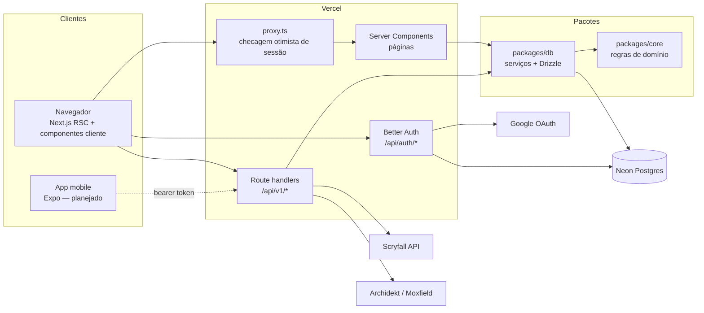
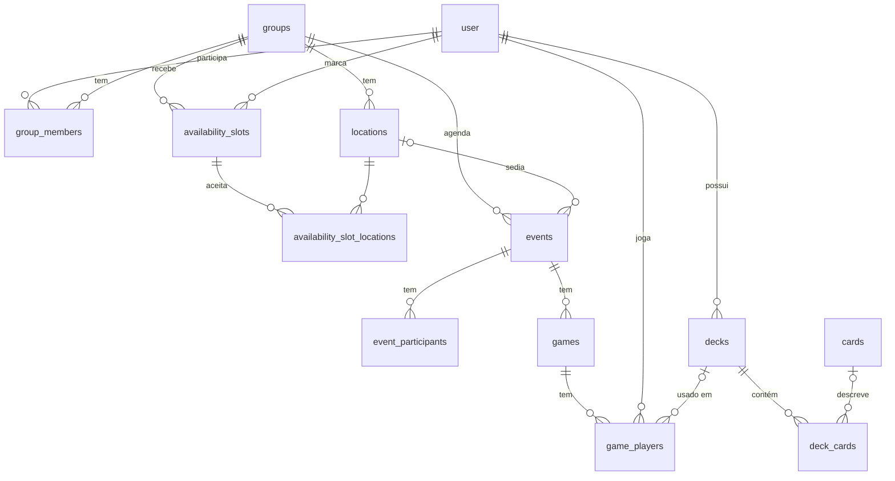

# Arquitetura

## Visão geral

### Camadas

| Camada  | Onde            | Responsabilidade                                                                                                                                                                      | Depende de                  |
| ------- | --------------- | ------------------------------------------------------------------------------------------------------------------------------------------------------------------------------------- | --------------------------- |
| Domínio | `packages/core` | Regras puras: janelas de disponibilidade, validação de partidas, ranking, parsing/importação de decks, cliente Scryfall (com `fetch` injetado), análise de deck. Sem banco, sem Next. | `zod`                       |
| Dados   | `packages/db`   | Schema Drizzle, migrations, **serviços** (casos de uso que leem/escrevem no banco e aplicam regras do core, incluindo permissões).                                                    | `core`, `drizzle-orm`, `pg` |
| Web     | `apps/web`      | UI (Server Components para leitura, componentes cliente chamando a API para escrita), API REST fina (auth + validação Zod + serviço), autenticação e i18n.                            | `db`, `core`, Next.js       |

Por que assim:

- **Mobile no futuro.** O app Expo vai consumir a mesma API REST (`/api/v1`) e importar `@boramarcar/core` para lógica de cliente (ex.: mostrar a curva de mana offline). Nada em `core` depende de Node, React ou banco.
- **Testabilidade.** Regras ficam em funções puras (testes unitários rápidos); serviços são testados contra Postgres real em memória (PGlite) com as migrations de verdade; route handlers são testados chamando as funções exportadas.
- **Rotas finas.** Cada route handler só autentica, valida a entrada com Zod e chama um serviço. O wrapper `authed()` em `apps/web/src/server/http.ts` converte `DomainError` em status HTTP.

### Erros

`DomainError(code, message)` (em `core`) é a única forma de sinalizar erros esperados. Códigos e status:

| Código           | HTTP                                       |
| ---------------- | ------------------------------------------ |
| `invalid_input`  | 400                                        |
| `unauthorized`   | 401                                        |
| `forbidden`      | 403                                        |
| `not_found`      | 404                                        |
| `conflict`       | 409                                        |
| `upstream_error` | 502 (Archidekt/Moxfield/Scryfall falharam) |

A UI traduz o código com `errors.<code>` nas mensagens.

## Modelo de dados

- `user`, `session`, `account`, `verification`: tabelas do Better Auth.
- `availability_slots` + `availability_slot_locations`: um intervalo de tempo de um jogador; sem locais vinculados = "qualquer local".
- `games.group_id` é desnormalizado para consultas de ranking por grupo.
- `game_players.result` ∈ `win | loss | draw`; validação: no máximo um vencedor; com vencedor não há empate; sem vencedor alguém empatou.
- `cards` é um **cache** do Scryfall (por `scryfall_id`); `deck_cards.card_name` guarda o nome mesmo quando a carta não foi encontrada.
- `deck_cards.is_proxy`: uma mesma carta pode ter uma linha original e outra proxy (índice único por deck/board/nome/proxy).

## Algoritmos

### Janelas de disponibilidade (`core/availability`)

Varredura de intervalos: os limites de todos os intervalos dividem a linha do tempo em segmentos; para cada local candidato e segmento, contamos quem está disponível e aceita aquele local (ou qualquer local). Segmentos contíguos com o mesmo conjunto de jogadores são unidos, janelas menores que a duração mínima são descartadas, e o resultado é ordenado por número de jogadores, duração e horário. Complexidade O(L · S · N) — irrelevante para grupos de amigos.

### Ranking (`core/ranking`)

Pontos configuráveis (padrão: vitória 3, empate 1, derrota 0). Desempate: pontos → vitórias → % de vitórias → menos jogos. Jogadores empatados em todos os critérios dividem a posição.

### Tipos de jogo (`core/games`)

Cada partida tem um `format` (texto, para poder adicionar tipos sem migration) com regras em `FORMAT_RULES`: **todos contra todos** (Commander, Brawl, Oathbreaker, Outro — 2 a 8 jogadores, um vencedor ou empate), **duelo** (Standard, Pioneer, Modern, Legacy, Vintage, Pauper, Draft, Selado — 2 jogadores) e **times** (Two-Headed Giant — dois times de 2; vence o time inteiro, então há 2 vencedores). Detalhes opcionais para estatísticas: quem começou, turno em que acabou, duração e ordem de eliminação. As configurações do grupo (`groups`: mesa, duração mínima, pontos e tipo padrão) valem para sugestões de horário, ranking e formulário de partida.

### Estatísticas e temporadas (`core/stats`)

`computeGroupStats` percorre as partidas em ordem cronológica: sequências de vitórias (atual e melhor), quem começou e venceu, quem saiu primeiro (menor ordem de eliminação), confronto direto (só adversários — em times, colegas não contam), vitórias por posição na mesa (só todos contra todos com 3+ jogadores), médias de turno e duração, e decks (partidas, vitórias, %). O serviço junta nomes, capas dos decks e agrupa por comandante. `resolvePeriod` traduz o filtro da página (todas, últimos 30 dias, este ano no fuso do usuário, ou uma temporada da tabela `seasons`, com fim exclusivo) em `[from, to)`, usado igualmente pelo ranking e pelas estatísticas.

### Análise de deck (`core/analysis`)

A análise depende do **formato do deck** (`decks.format`, escolhido na importação ou detectado no Archidekt/Moxfield; `formats.ts` tem o perfil de cada um):

| Perfil     | Formatos                                                                                  | Regras verificadas                                          | Nota |
| ---------- | ----------------------------------------------------------------------------------------- | ----------------------------------------------------------- | ---- |
| Comandante | Commander (100, 1–2 comandantes), Brawl (100, 1), Oathbreaker (60, planeswalker + mágica) | tamanho exato, singleton, identidade de cor                 | sim  |
| Construído | Standard, Pioneer, Modern, Legacy, Vintage, Pauper, Two-Headed Giant                      | mínimo 60, até 4 cópias (principal + reserva), reserva ≤ 15 | não  |
| Limitado   | Draft, Selado                                                                             | mínimo 40                                                   | não  |
| Livre      | Outro                                                                                     | só cartas desconhecidas                                     | não  |

A lista de banidas não é conferida.

1. **Funções** (4.5): as do **Scryfall Tagger** (`otag:ramp`, `card-advantage`, `removal`, `sweeper`, `tutor`, `protection`, `recursion`, `counterspell`), guardadas em `cards.roles` por 30 dias; enquanto a carta não foi consultada, vale a heurística por regex no texto. A tela mostra quantas cartas vieram do Tagger.
2. Curva de mana (principal, sem terrenos), símbolos por cor, CMC médio.
3. **Nota 0–100** só nos formatos com comandante: terrenos (25), ramp (20), compra (20), remoção (15), wipes (10), curva (10), com metas do perfil (Oathbreaker tem metas menores).
4. **Alternativas** (4.6): `GET /api/v1/decks/:id/alternatives?role&maxCmc` busca no Scryfall `id<=<cores> otag:<função> f:<formato> cmc<=N` ordenado por EDHREC e tira as cartas que já estão no deck.
5. **Bracket** (4.7, só Commander): `estimateBracket` aplica as regras objetivas dos brackets oficiais (Game Changers: nenhum até o 2, até 3 no 3; destruição em massa de terrenos e turnos extras encadeados → 4+; combo de duas cartas → 4+, "talvez de duas" → 3+). Os sinais vêm do endpoint `estimate-bracket` do **Commander Spellbook** e ficam em `decks.bracket_signals` com o hash da lista (`bracket_hash`); se a lista mudou, a tela usa só os Game Changers do Scryfall até a próxima consulta. O resultado é um mínimo — intenção e velocidade ficam com a mesa.
6. **Base de mana** (4.8): terrenos que geram cada cor (`cards.produced_mana`) contra uma meta proporcional aos símbolos, com mínimo de 10 (Commander) ou 7 (60 cartas) para splash.
7. **Mão inicial** (4.9): hipergeométrica — distribuição de terrenos na mão de 7, chance de 2–4 terrenos, jogada de terreno em todos os turnos até o 2–5 (jogando primeiro/depois) e ramp até o turno 2–3.

**Atualização dos dados externos** (`server/deck-analysis.ts`): depois de importar ou sincronizar (e ao abrir um deck com dados velhos), `refreshDeckAnalysis` roda após a resposta (`after`) e, em etapas independentes, completa a mana produzida de cartas de cache antigo, consulta o Tagger (~8 funções × 2–3 buscas de até 1000 caracteres, 100 ms entre elas) e o Spellbook. O botão "Atualizar análise" chama `POST /api/v1/decks/:id/analysis`.

## Notificações por e-mail

- **Quando**: encontro novo (grupo todo), encontro alterado ou cancelado (quem não recusou), lembrete das próximas 24h (cron diário da Vercel em `/api/cron/reminders`, protegido por `CRON_SECRET`) e "a mesa fechou!" (depois de alguém marcar disponibilidade, se surge uma janela nos próximos 14 dias sem encontro marcado). Quem fez a ação não recebe o próprio aviso.
- **Uma vez só**: o lembrete marca `events.reminder_sent_at` com um `UPDATE ... WHERE reminder_sent_at IS NULL` (remarcar zera o campo); "a mesa fechou!" grava a chave `dia|local` em `window_notifications` (`ON CONFLICT DO NOTHING`).
- **Sem atrasar a resposta**: as rotas agendam o envio com `after()` do Next (`server/background.ts`); erros vão para o log e não afetam a ação do usuário.
- **Conteúdo**: `server/email.ts` monta HTML (texto escapado) e texto puro no idioma (`user.locale`) e no fuso (`user.time_zone`) de quem recebe, com o `.ics` anexo (mesmo UID/SEQUENCE do download, então a agenda atualiza o evento). `core/email` fala com a API do Resend, um e-mail por destinatário.
- **Opt-out**: `user.email_notifications`, no perfil. Sem `RESEND_API_KEY`, nada é enviado.

## Perfis, visibilidade e conquistas

- **Visibilidade do deck** (`decks.visibility`): `private` (só o dono), `group` (padrão: quem divide grupo com o dono) e `public` (qualquer pessoa com conta e o link). Vale para a página do deck e para o perfil.
- **Perfil do jogador** (`/jogadores/:id`, API `/api/v1/players/:id`): só para quem divide um grupo (senão, 404 — não revela quem usa o app). Mostra resumo, títulos de temporada, conquistas e decks visíveis; e-mail e grupos que não são em comum só para o próprio jogador.
- **Conquistas** (`core/achievements`): calculadas na hora a partir das partidas (sem tabela), em ordem cronológica, com a data em que cada objetivo foi alcançado — editar ou remover uma partida recalcula tudo. "Campeão da temporada" usa o ranking de cada temporada encerrada.

## Preços em reais

O Scryfall só tem preço em dólar. O valor em reais é **conversão** pelo dólar PTAX de venda do Banco Central (API pública `olinda.bcb.gov.br`, sem chave), guardado por 6 h por instância; se o BCB falhar, a página mostra só US$. A LigaMagic não tem API pública e bloqueia acesso automático, então cada carta tem um link "Ver preço na LigaMagic" em vez de copiar preços de lá. O teste de contrato semanal também chama a PTAX.

## Folha de proxies (PDF)

`core/decks/proxies` calcula a grade (3×3 cartas de 63×88 mm centralizadas em A4 ou Carta) e a lista de cópias a imprimir; `server/proxy-sheet.ts` monta o PDF com `pdf-lib`, baixando as imagens "large" do Scryfall (no máximo 6 por vez, uma vez por carta) e desenhando marcas de corte. Carta sem imagem vira um retângulo com o nome. O PDF do servidor depende de o servidor conseguir baixar as imagens do Scryfall (com `User-Agent`/`Accept` próprios, caindo para o tamanho `normal`; o header `X-Missing-Images` informa quantas faltaram). Por isso o caminho principal é a página `/decks/:id/imprimir`: o próprio navegador carrega as imagens e o usuário imprime ou salva como PDF, com CSS em milímetros e `@page` sem margens.

## Símbolos de mana

`components/mana.tsx` converte custos do Scryfall (`{2}{G}{W/U}{G/P}`) em glifos do [Mana Font](https://mana.andrewgioia.com) (SIL OFL 1.1, CSS MIT; símbolos © Wizards of the Coast), servido localmente (`public/fonts/mana.woff2`, sem dependência de CDN). O CSS é um subconjunto (cores, números 0–20, X/Y/Z, híbridos, phyrexianos, neve, virar) com seletores sempre prefixados por `.ms` para não colidir com o Tailwind.

## Autenticação

Better Auth com o provedor Google e adaptador Drizzle. Sessões ficam no Postgres; o cookie é cacheado por 5 minutos (`cookieCache`) para evitar uma consulta por requisição. `proxy.ts` (antigo `middleware.ts` no Next 16) só verifica a presença do cookie; a validação real acontece nas páginas (`requireUser`) e na API (`authed`).

## Internacionalização

next-intl sem prefixo de idioma na URL. O idioma vem do cookie `NEXT_LOCALE` e, na falta dele, do `Accept-Language`; padrão `pt-BR`. As mensagens são tipadas a partir de `messages/pt-BR.json` e um teste garante que `en.json` tem as mesmas chaves. Cada usuário tem um fuso (`user.time_zone`), detectado no navegador no primeiro acesso e editável em /perfil; ele é espelhado no cookie `bm_tz`, lido pelo next-intl a cada requisição. Os horários digitados em `datetime-local` são convertidos para UTC no fuso do usuário (`zonedLocalToUtc` em `core/time`). Sem preferência, o padrão é `America/Sao_Paulo`.
